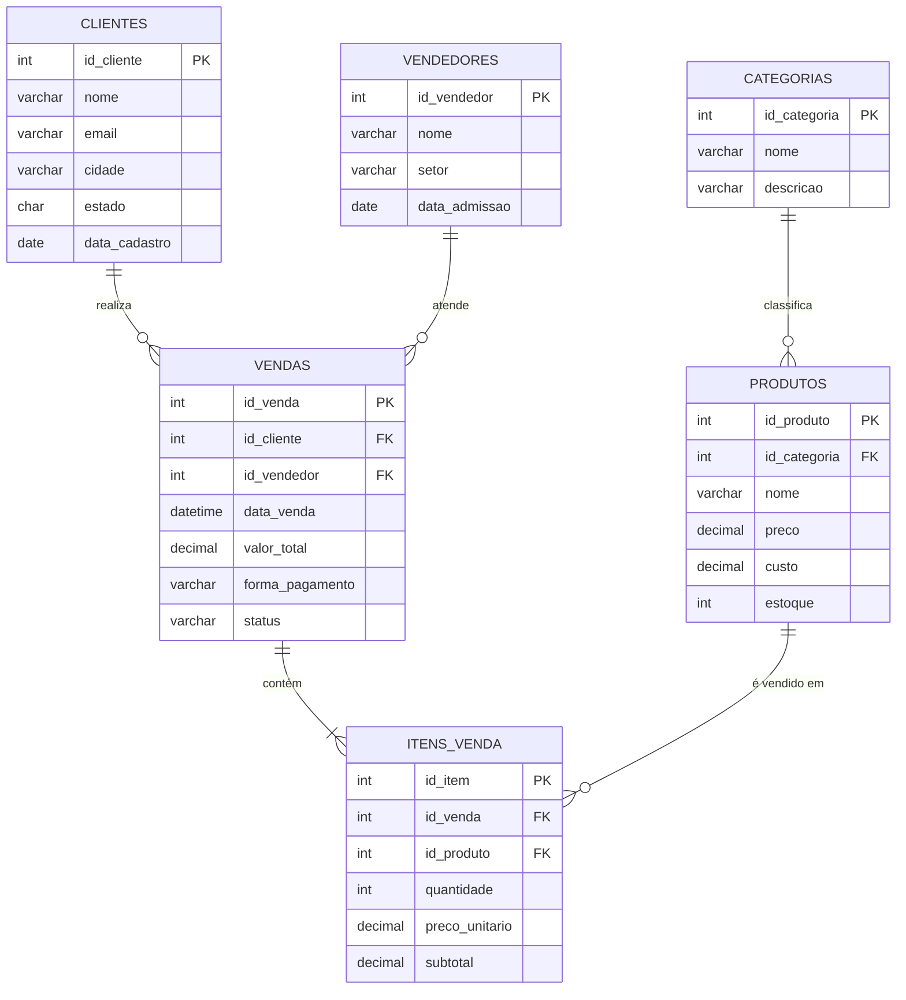

# Dicionário de dados — TechNova Informática

Base sintética gerada pelo gerador Java (`Gerador/`), gravada no MySQL (`gerador_bi`) e exportada em CSV (`arquivos_csv/`).
Volume: 25 categorias, 500 clientes, 30 vendedores, 100 produtos, 5.000 vendas e 10.442 itens de venda (16.097 registros), de nov/2024 a out/2026.

**Por que esse volume:** 5.000 vendas em 24 meses dão cerca de 200 pedidos por mês, o suficiente para comparar meses, canais, categorias e UFs sem grupos vazios. Os 24 meses cobrem dois ciclos sazonais (duas Black Fridays e dois Natais), necessários para ver tendência e sazonalidade e fazer previsão. Os 500 clientes com cerca de 10 compras em média permitem segmentar por frequência e valor.

## Diagrama de relacionamentos

Não existe relacionamento direto entre clientes e vendedores: eles se ligam apenas pela tabela `vendas`.

**Granularidade:** `itens_venda` = um produto dentro de uma venda (nível mais detalhado, tabela fato); `vendas` = um pedido (cabeçalho, com o total); as demais tabelas são dimensões (uma linha por categoria, cliente, vendedor e produto).

## Tabelas de origem

### categorias — dimensão (25 linhas)
| Campo | Tipo | Descrição | Chave / relacionamento |
| --- | --- | --- | --- |
| id_categoria | INT | Identificador da categoria | PK |
| nome | VARCHAR(80) | Nome da categoria (ex.: Placas de Vídeo) | |
| descricao | VARCHAR(255) | Descrição da categoria | |

### clientes — dimensão (500 linhas)
| Campo | Tipo | Descrição | Chave / relacionamento |
| --- | --- | --- | --- |
| id_cliente | INT | Identificador do cliente | PK |
| nome | VARCHAR(100) | Nome fictício do cliente (dado pessoal) | |
| email | VARCHAR(120) | E-mail fictício (dado pessoal) | Único |
| cidade | VARCHAR(80) | Cidade do cliente | |
| estado | CHAR(2) | UF do cliente | |
| data_cadastro | DATE | Data de cadastro (até 5 anos antes de 31/10/2026) | |

### vendedores — dimensão (30 linhas)
| Campo | Tipo | Descrição | Chave / relacionamento |
| --- | --- | --- | --- |
| id_vendedor | INT | Identificador do vendedor | PK |
| nome | VARCHAR(100) | Nome fictício do vendedor (único) | |
| setor | VARCHAR(50) | Canal de venda: Loja Física, Vendas Online, Televendas ou Vendas Corporativas | |
| data_admissao | DATE | Data de admissão (até 8 anos antes de 31/10/2026) | |

### produtos — dimensão (100 linhas)
| Campo | Tipo | Descrição | Chave / relacionamento |
| --- | --- | --- | --- |
| id_produto | INT | Identificador do produto | PK |
| id_categoria | INT | Categoria do produto | FK → categorias |
| nome | VARCHAR(100) | Nome do produto (ex.: GeForce RTX 4070) | |
| preco | DECIMAL(10,2) | Preço de venda de tabela (R$) | |
| custo | DECIMAL(10,2) | Custo unitário da mercadoria (R$), entre 50% e 85% do preço | |
| estoque | INT | Unidades em estoque em 31/10/2026 | |

### vendas — fato no nível do pedido (5.000 linhas)
| Campo | Tipo | Descrição | Chave / relacionamento |
| --- | --- | --- | --- |
| id_venda | INT | Identificador da venda (pedido) | PK |
| id_cliente | INT | Cliente que comprou | FK → clientes |
| id_vendedor | INT | Vendedor que atendeu (define o canal) | FK → vendedores |
| data_venda | DATETIME | Data e hora da venda (08h–21h) | |
| valor_total | DECIMAL(10,2) | Soma dos subtotais dos itens (R$) | |
| forma_pagamento | VARCHAR(20) | PIX, Crédito, Débito, Boleto ou Dinheiro | |
| status | VARCHAR(30) | Concluída, Pendente ou Cancelada | |

### itens_venda — fato no nível do item (10.442 linhas)
| Campo | Tipo | Descrição | Chave / relacionamento |
| --- | --- | --- | --- |
| id_item | INT | Identificador do item | PK |
| id_venda | INT | Venda a que o item pertence | FK → vendas |
| id_produto | INT | Produto vendido | FK → produtos (único por venda) |
| quantidade | INT | Unidades vendidas | |
| preco_unitario | DECIMAL(10,2) | Preço praticado (= preço de tabela) | |
| subtotal | DECIMAL(10,2) | quantidade × preco_unitario | |

## Tabelas tratadas (saída do ETL, `dados_tratados/`)

Criadas por `etl/etl.py`. Nome e e-mail dos clientes **não** passam para a base tratada (minimização de dados pessoais).

### fato_vendas — 1 linha por pedido
Todos os campos de `vendas`, mais:

| Campo | Tipo | Descrição / regra |
| --- | --- | --- |
| qtd_itens | inteiro | Número de produtos diferentes no pedido |
| qtd_unidades | inteiro | Soma das quantidades dos itens |
| custo_total | decimal | Σ (quantidade × custo do produto) |
| lucro_bruto | decimal | valor_total − custo_total |
| concluida | booleano | status = Concluída |
| estado, regiao | texto | UF e região do cliente (Norte, Nordeste, Centro-Oeste, Sudeste, Sul) |
| canal | texto | Setor do vendedor |
| data, ano, mes, ano_mes, trimestre, dia_semana, hora | data/texto/inteiro | Partes da data da venda, para agrupar |

### fato_itens — 1 linha por produto vendido
Todos os campos de `itens_venda`, mais `produto`, `id_categoria`, `categoria`, `custo_unitario`, `custo_total`, `lucro_bruto` (subtotal − custo_total) e os atributos do pedido (`data_venda`, `ano_mes`, `status`, `concluida`, `canal`, `estado`, `regiao`, `id_cliente`, `id_vendedor`, `forma_pagamento`).

### dim_produtos
Campos de `produtos`, mais `categoria` (nome), `margem_unitaria` (preco − custo), `margem_pct` (margem ÷ preço × 100) e `faixa_preco` (Até R$100, R$100–500, R$500–1.500, R$1.500–5.000, Acima de R$5.000).

### dim_clientes
`id_cliente`, `cidade`, `estado`, `data_cadastro` e `regiao` (sem nome e e-mail).

### dim_vendedores
`id_vendedor`, `nome`, `canal` (antigo `setor`), `data_admissao` e `tempo_casa_anos`.

### dim_categorias
Igual à tabela de origem.
