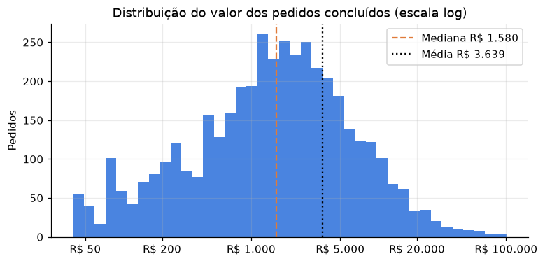
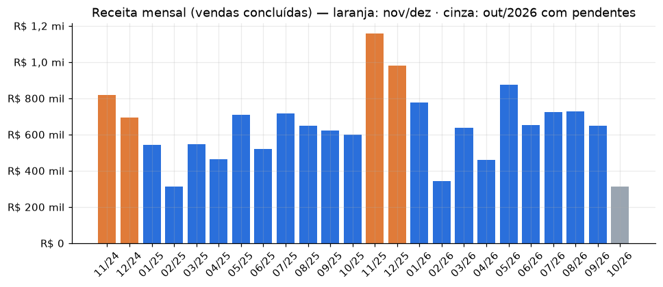
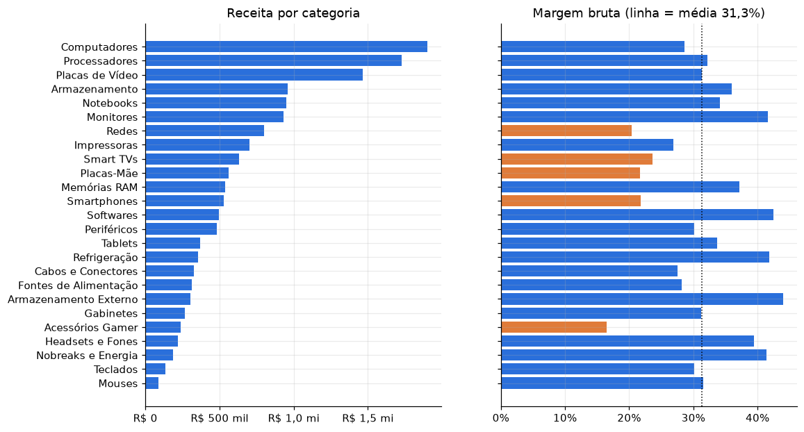
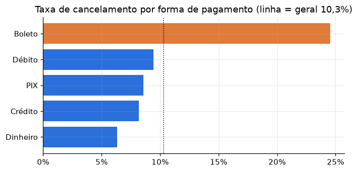
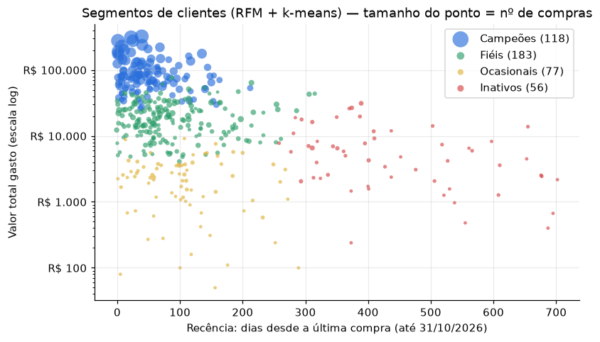
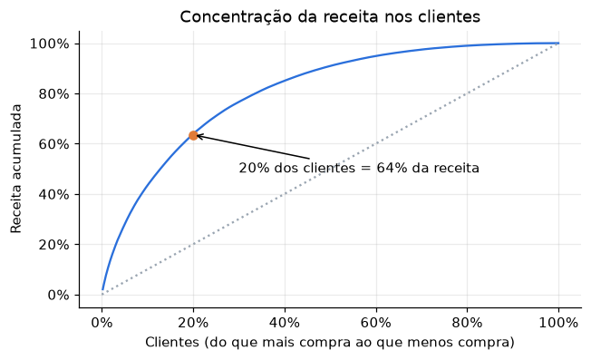
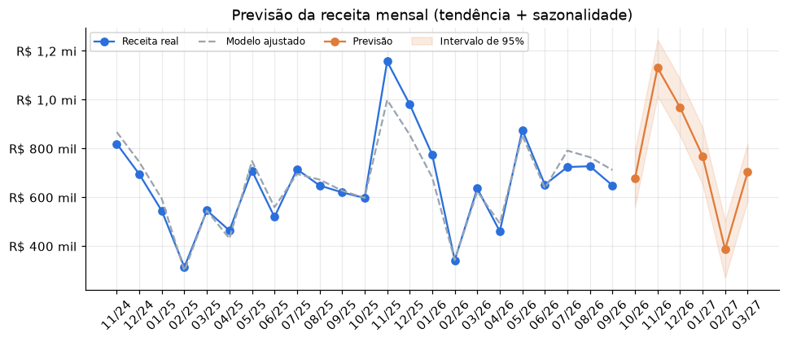

# Relatório de análise — TechNova Informática

Gerado automaticamente por `analise/analise.py` a partir da base tratada pelo ETL. Período: nov/2024 a out/2026.

## 1. Estatística descritiva

Pedidos concluídos analisados: **4.254** de 5.000.

| Variável | Média | Mediana | Desvio padrão | Mín | Q1 | Q3 | Máx | Assimetria |
| --- | --- | --- | --- | --- | --- | --- | --- | --- |
| Valor do pedido (R$) | 3.639,2 | 1.579,5 | 6.732,4 | 39,9 | 569,8 | 3.847,1 | 100.818,4 | 5,76 |
| Produtos por pedido | 2,1 | 2,0 | 1,2 | 1,0 | 1,0 | 3,0 | 5,0 | 0,87 |
| Unidades por pedido | 4,9 | 3,0 | 5,5 | 1,0 | 2,0 | 6,0 | 43,0 | 2,80 |
| Lucro bruto do pedido (R$) | 1.140,4 | 482,4 | 2.125,5 | 12,6 | 173,8 | 1.199,9 | 33.332,9 | 6,09 |

O valor dos pedidos é **muito assimétrico**: a média (R$ 3.639) é mais que o dobro da mediana (R$ 1.580), puxada por poucos pedidos grandes (máximo de R$ 100.818). Por isso o ticket médio deve ser lido junto com a mediana.

## 2. KPIs do período (nov/2024 a out/2026)

| # | KPI | Valor | Unidade |
| --- | --- | --- | --- |
| K1 | Receita líquida | R$ 15.481.230,20 | R$ |
| K2 | Pedidos concluídos | 4.254 | pedidos |
| K3 | Ticket médio | R$ 3.639,22 | R$/pedido |
| K4 | Crescimento da receita (jan–set 2026 vs 2025) | 15,0% | % |
| K5 | Margem bruta | 31,3% | % |
| K6 | Taxa de cancelamento | 10,3% | % |
| K7 | Receita perdida em cancelamentos | R$ 1.767.673,50 | R$ |
| K8 | Itens por pedido | 2,09 | itens/pedido |
| K9 | Participação do maior canal (Corporativo) | 47,6% | % |
| K10 | Clientes ativos (compra nos últimos 180 dias) | 68,4% | % |
| K11 | Receita dos 10% melhores clientes | 43,2% | % |
| K12 | Produtos com cobertura de estoque < 1 mês | 5 | produtos |

Receita, ticket, margem e K4 consideram só vendas concluídas. O K4 compara jan–set porque out/2026 ainda tem pedidos pendentes e ficaria subestimado.

## 3. Comparações por dimensão

### 3.1 Evolução mensal

Há **sazonalidade forte**: novembro (Black Friday) e dezembro (Natal) são os picos, e fevereiro é o vale (média de R$ 327.942). Nov/2025 faturou 41,2% a mais que nov/2024. A queda de out/2026 não é real: 125 pedidos daquele mês ainda estão pendentes.

### 3.2 Canais de venda

| Canal | Receita | Pedidos | Ticket médio | % da receita | % dos pedidos |
| --- | --- | --- | --- | --- | --- |
| Vendas Corporativas | R$ 7.370.456 | 749 | R$ 9.840 | 47,6% | 17,6% |
| Loja Física | R$ 4.081.362 | 1721 | R$ 2.372 | 26,4% | 40,5% |
| Vendas Online | R$ 2.883.354 | 1209 | R$ 2.385 | 18,6% | 28,4% |
| Televendas | R$ 1.146.057 | 575 | R$ 1.993 | 7,4% | 13,5% |

O canal **Corporativo** tem só 17,6% dos pedidos, mas 47,6% da receita: o ticket médio (R$ 9.840) é cerca de 4 vezes o dos outros canais, porque empresas compram em lote.

### 3.3 Categorias: receita × margem

Curva ABC: **13 das 25 categorias** fazem 80% da receita (classe A), lideradas por Computadores, Processadores, Placas de Vídeo. As margens mais baixas são de Acessórios Gamer (16,5%), Redes (20,4%), Placas-Mãe (21,7%); as mais altas, de Armazenamento Externo (44,0%), Softwares (42,5%), Refrigeração (41,8%).

### 3.4 Produtos e risco de ruptura

**Top 10 em receita:**

| Produto | Categoria | Unidades | Receita |
| --- | --- | --- | --- |
| PC Gamer | Computadores | 100 | R$ 793.990 |
| GeForce RTX 4080 | Placas de Vídeo | 85 | R$ 603.492 |
| Switch 24 Portas | Redes | 439 | R$ 526.756 |
| Notebook Corporativo | Notebooks | 110 | R$ 525.789 |
| Intel Core i9 | Processadores | 119 | R$ 411.728 |
| PC Desktop | Computadores | 105 | R$ 405.290 |
| GeForce RTX 3050 | Placas de Vídeo | 312 | R$ 399.329 |
| Mini PC | Computadores | 231 | R$ 397.297 |
| Smartphone Premium | Smartphones | 79 | R$ 389.462 |
| Intel Core i5 | Processadores | 256 | R$ 350.694 |

**Menor cobertura de estoque (K12):**

| Produto | Estoque | Venda média/mês | Cobertura (meses) |
| --- | --- | --- | --- |
| Monitor LED 21.5 | 3 | 7,8 | 0,39 |
| Microfone Condensador | 7 | 12,0 | 0,59 |
| Fonte 500W | 4 | 6,4 | 0,63 |
| Switch 24 Portas | 13 | 18,3 | 0,71 |
| Impressora Jato de Tinta | 9 | 11,9 | 0,76 |
| Mini PC | 15 | 9,6 | 1,56 |
| SSD SATA 480GB | 37 | 19,5 | 1,90 |
| Intel Core i7 | 5 | 2,6 | 1,94 |

**5 produtos** têm estoque para menos de 1 mês de vendas.

### 3.5 Cancelamentos por forma de pagamento

O **boleto cancela 24,5%** dos pedidos, contra 8,4% nas demais formas, e responde por R$ 534.945 em vendas perdidas (30,3% do total cancelado), apesar de ser só cerca de 12% dos pedidos.

Teste qui-quadrado (boleto × demais, 1 grau de liberdade): χ² = 147,0, muito acima do valor crítico de 3,84 (5% de significância), então a diferença **não é acaso**.

### 3.6 Regiões

| Região | Receita | Clientes | Receita por cliente |
| --- | --- | --- | --- |
| Nordeste | R$ 4.845.680 | 123 | R$ 39.396 |
| Sudeste | R$ 3.400.098 | 94 | R$ 36.171 |
| Sul | R$ 3.281.724 | 81 | R$ 40.515 |
| Norte | R$ 2.322.269 | 80 | R$ 29.028 |
| Centro-Oeste | R$ 1.631.459 | 56 | R$ 29.133 |

O Nordeste lidera em receita porque concentra mais clientes compradores (123). Por cliente, Sul (R$ 40.515) fica no topo e Norte (R$ 29.028) por último, uma diferença de 28%.

### 3.7 Vendedores

Para comparar vendedores de forma justa, dividimos os pedidos pelos meses que cada um trabalhou dentro do período (quem foi admitido depois teve menos tempo para vender).

Mesmo assim a diferença é grande: na Loja Física, de 2,9 a 12,3 pedidos por mês (coeficiente de variação de 46%). A diferença não vem do tempo de casa, e sim do desempenho: há espaço para treinar os vendedores abaixo da média com as práticas dos melhores.

## 4. Técnica analítica 1 — Segmentação de clientes (RFM + k-means)

**Método:** para cada cliente com compra concluída calculamos **R**ecência (dias desde a última compra até 31/10/2026), **F**requência (número de compras) e **V**alor (total gasto). F e V passam por log (são muito assimétricos), as três variáveis são padronizadas e agrupadas com **k-means**.

**Escolha do número de grupos:** testamos k de 2 a 7. A silhueta mede quão bem separados estão os grupos (de −1 a 1; acima de 0,25 indica estrutura razoável).

| k | Inércia | Silhueta |
| --- | --- | --- |
| 2 | 677,9 | 0,421 |
| 3 | 449,1 | 0,412 |
| 4 | 320,5 | 0,386 |
| 5 | 267,2 | 0,383 |
| 6 | 219,2 | 0,364 |
| 7 | 193,0 | 0,321 |

Escolhemos **k = 4**: k = 2 tem silhueta um pouco maior, mas só separa quem compra muito de quem compra pouco; k = 3 acrescenta os inativos, mas ainda mistura clientes regulares com compradores de uma ou duas compras. Com k = 4 a silhueta (0,386) continua próxima da melhor e surgem perfis acionáveis (inativos, ocasionais, fiéis, campeões); a partir de 5 grupos a separação piora sem trazer perfis novos.

| Segmento | Clientes | Recência média (dias) | Compras (média) | Valor por cliente | % da receita | Ação sugerida |
| --- | --- | --- | --- | --- | --- | --- |
| Campeões | 118 | 53 | 24,2 | R$ 94.710 | 72,2% | Atendimento dedicado, condições VIP, não deixar migrar para concorrente |
| Fiéis | 183 | 91 | 6,2 | R$ 20.253 | 23,9% | Programa de fidelidade e venda de itens complementares para subir o ticket |
| Inativos | 56 | 443 | 2,1 | R$ 7.265 | 2,6% | Campanha de reativação com cupom; entender o motivo da saída |
| Ocasionais | 77 | 108 | 1,8 | R$ 2.499 | 1,2% | Campanhas sazonais (Black Friday) e ofertas para aumentar a frequência |

Além desses, **66 clientes cadastrados nunca concluíram uma compra** e são um quinto grupo para campanha de primeira compra.

## 5. Técnica analítica 2 — Previsão da receita

**Método:** decomposição clássica. (1) Para cada mês do ano calculamos um **índice sazonal** (receita média do mês ÷ média geral). (2) Dividimos a série por esse índice e ajustamos uma **tendência linear**. (3) A previsão é tendência × índice do mês. Out/2026 ficou fora do ajuste por ter pedidos pendentes.

**Validação (backtest):** o modelo foi treinado só com nov/2024–dez/2025 e previu jan–set/2026.

| Modelo | MAPE (erro médio por mês) | Erro no total de jan–set |
| --- | --- | --- |
| Tendência + sazonalidade | 12,1% | 5,5% |
| Ingênuo (repete o mesmo mês de 2025) | 12,1% | -13,1% |

Mês a mês, os dois modelos erram parecido (cerca de 12%), porque a receita mensal oscila com pedidos corporativos grandes que caem em um mês ou em outro. No **total do período**, porém, o modelo erra 5,5% contra 13,1% do ingênuo, que ignora o crescimento. Por isso a previsão serve para planejar **trimestres e a temporada de fim de ano**, não um mês isolado.

| Mês | Previsão | Intervalo de 95% |
| --- | --- | --- |
| 2026-10 | R$ 677.031 | R$ 560.996 a R$ 793.066 |
| 2026-11 | R$ 1.130.839 | R$ 1.014.804 a R$ 1.246.874 |
| 2026-12 | R$ 968.204 | R$ 852.170 a R$ 1.084.239 |
| 2027-01 | R$ 769.250 | R$ 653.215 a R$ 885.285 |
| 2027-02 | R$ 386.283 | R$ 270.249 a R$ 502.318 |
| 2027-03 | R$ 702.819 | R$ 586.784 a R$ 818.853 |

Tendência: a receita dessazonalizada cresce cerca de R$ 7.304 por mês (1,1% da média mensal). Out/2026 aparece na previsão como estimativa do mês completo, depois que os pendentes forem resolvidos.

## 6. Padrões, anomalias e oportunidades

- **Pedidos atípicos:** 7 pedidos acima de R$ 67.486 (critério IQR em escala log). 100% deles são do canal Corporativo: não são erros, são compras em lote de empresas, e explicam a oscilação mensal da receita.
- **Meses fora da curva** (z = distância da média em desvios padrão): nov/2025 (z = 2,6) é o pico do período; fev/2025 e fev/2026 (z = -1,7 e -1,5) são os vales. Out/2026 (z = -1,7) é uma anomalia de **dado incompleto** (pendentes), não de negócio.
- **Dia da semana:** sábado é o dia mais forte (677 pedidos concluídos) e domingo o mais fraco (389), 40% abaixo da média dos outros dias.
- **Horário:** as vendas são distribuídas de forma uniforme entre 8h e 21h, sem pico de horário.
- **Oportunidades:** reduzir o cancelamento do boleto, proteger e expandir o canal Corporativo, reativar clientes inativos e repor os produtos com estoque crítico antes da Black Friday.

## 7. Avaliação crítica e limitações

- **Dados sintéticos:** os padrões encontrados (sazonalidade, cancelamento do boleto, concentração de clientes) foram embutidos no gerador; a análise mostra que o pipeline consegue **detectá-los e medi-los**, mas não prova que existam numa empresa real.
- **Receita de out/2026 subestimada** pelos pedidos pendentes; por isso K4 e a previsão usam só meses completos.
- **Previsão:** só há 2 ciclos sazonais; o erro mês a mês (MAPE 12,1%) é alto por causa dos pedidos corporativos grandes. O modelo não considera promoções, preços, concorrência nem economia.
- **Margem bruta:** não inclui frete, impostos, comissões e despesas; o custo do produto é fixo no período.
- **K-means:** depende da escala das variáveis e do número de grupos escolhido; a silhueta moderada indica que os segmentos têm fronteiras suaves (clientes perto da fronteira podem mudar de grupo).
- **Cobertura de estoque:** usa a venda média de 24 meses e o estoque de uma única data; não considera pedidos de compra em andamento nem a sazonalidade do produto.

